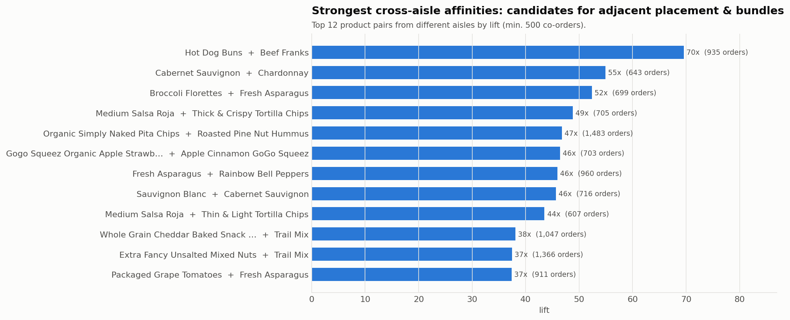
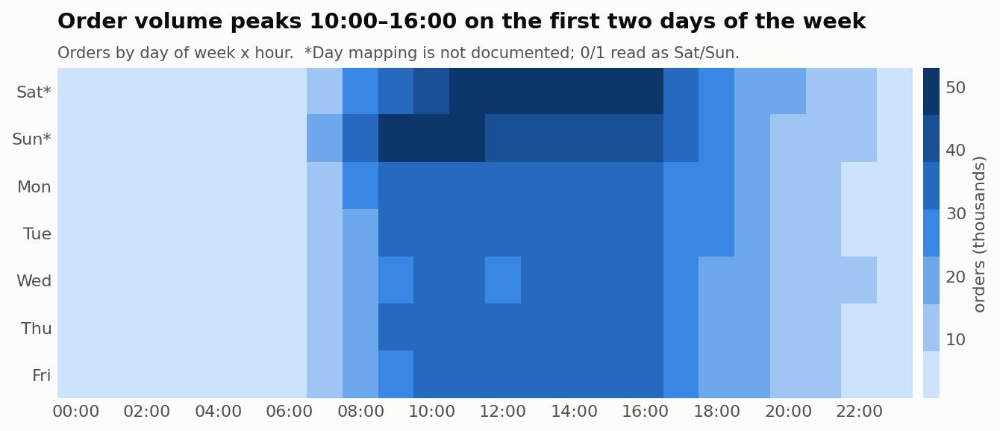
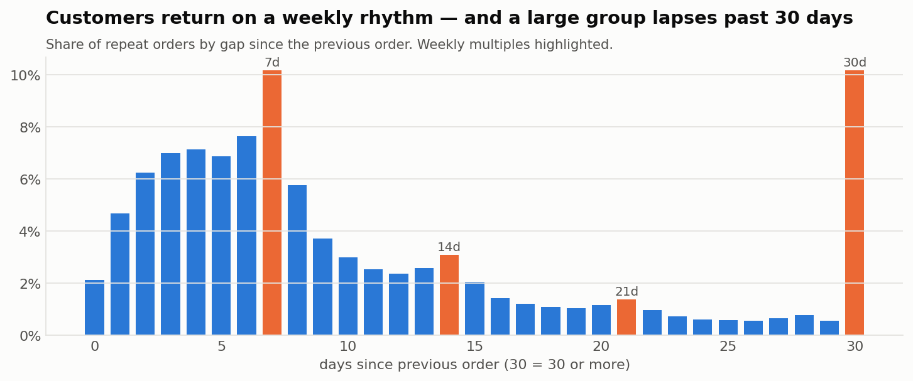
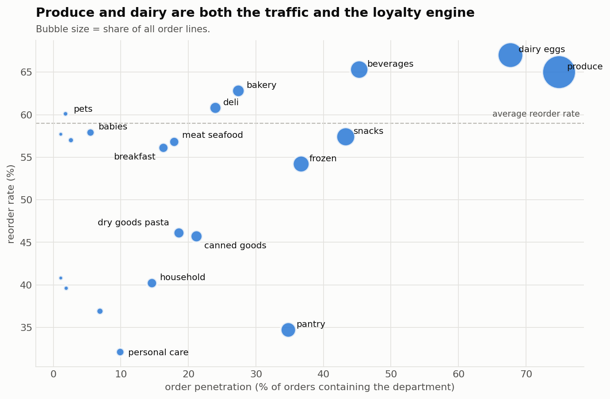
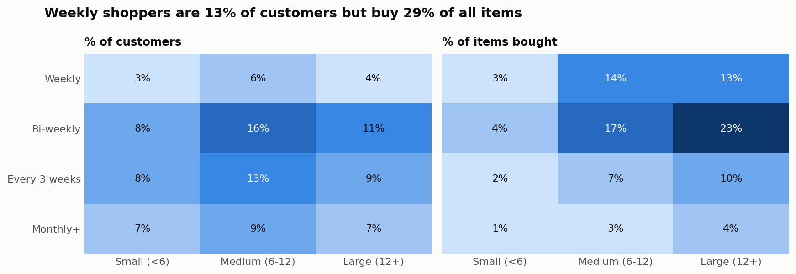

# Grocery Basket Analysis

**What do grocery customers buy together, when do they shop, and how often do they come back?**
An end-to-end market basket analysis of **3.2M orders / 32.4M order lines** from Instacart, built with
**SQL (DuckDB)** for all aggregation and Python for association-rule mining and visualisation. Every finding ends in
a concrete retail action.

➡️ **[Read the full analysis notebook](notebooks/basket_analysis.ipynb)**



## Key findings

| | Finding | Action for a grocery retailer |
|---|---|---|
| 🔁 | **59%** of order lines are reorders; top staples are reordered 75–85% of the time | Make "buy again" the default entry point; pre-filled baskets |
| 🕙 | **57%** of orders are placed 10:00–16:00 | Weight delivery slots & picker staffing; off-peak incentives |
| 📅 | **58%** of repeat orders come within 8 days (spike at exactly day 7); **10%** come after 30+ days | Replenishment reminder on day 6–7; 21+ day gap = churn signal |
| 🥬 | Produce: in **75%** of orders, 65% reorder rate · Pantry: 35% of orders, only **35%** reorder rate | Fresh quality = loyalty lever; pantry = promo lever |
| 🥛 | Milk is picked first **2.1×** more than its share predicts | "Mission" categories belong on the home screen / store entry |
| 🌮 | Hot-dog buns + franks (**lift 70**), salsa + tortilla chips (**49**), pita chips + hummus (**47**) | "Complete the meal" bundles, secondary placements, cart recommendations |
| 👥 | Weekly shoppers are **13%** of customers but buy **29%** of items | Prioritise them in the loyalty programme |

<table>
<tr>
<td></td>
<td></td>
</tr>
<tr>
<td></td>
<td></td>
</tr>
</table>

## Approach

1. **Data layer:** raw CSVs are converted to Parquet once ([`src/prepare_data.py`](src/prepare_data.py)) and exposed
   as SQL views ([`sql/00_views.sql`](sql/00_views.sql)).
2. **SQL analysis:** each business question is a standalone, readable query in [`sql/`](sql):

   | Query | Technique |
   |---|---|
   | [`01_kpis.sql`](sql/01_kpis.sql) | CTEs, scalar sub-queries, `MEDIAN` |
   | [`03_repurchase_cycle.sql`](sql/03_repurchase_cycle.sql) | window functions for share of total |
   | [`04_department_performance.sql`](sql/04_department_performance.sql) | penetration vs. loyalty |
   | [`06_first_in_cart.sql`](sql/06_first_in_cart.sql) | index vs. expected share, `QUALIFY` |
   | [`07_product_pairs.sql`](sql/07_product_pairs.sql) | **support / confidence / lift via self-join** |
   | [`08_customer_segments.sql`](sql/08_customer_segments.sql) | behavioural segmentation with `CASE` |

3. **Association rules:** Apriori ([mlxtend](https://rasbt.github.io/mlxtend/)) on 300K sampled baskets at aisle level.
4. **Interpretation:** same-aisle high-lift pairs (flavour variants → multi-buy offers) are separated from cross-aisle
   complements (→ placement and bundles), because they call for different actions.

## Run it yourself

```bash
git clone https://github.com/<your-username>/grocery-basket-analysis.git
cd grocery-basket-analysis
python -m venv .venv && source .venv/bin/activate   # Windows: .venv\Scripts\activate
pip install -r requirements.txt
```

Download the [Instacart dataset from Kaggle](https://www.kaggle.com/datasets/psparks/instacart-market-basket-analysis)
and put `orders.csv`, `order_products__prior.csv`, `products.csv`, `aisles.csv`, `departments.csv` in `data/`. Then:

```bash
python src/prepare_data.py
jupyter notebook notebooks/basket_analysis.ipynb
```

The full notebook runs in about 1 minute on a laptop (DuckDB handles the 32M-row self-joins in seconds).

## Project structure

```
├── data/                 # raw CSVs + parquet (git-ignored)
├── figures/              # charts used in this README
├── notebooks/
│   └── basket_analysis.ipynb
├── sql/                  # one query per business question
└── src/
    ├── prepare_data.py   # CSV -> Parquet
    ├── sql_runner.py     # loads ./sql files, returns DataFrames
    └── style.py          # shared chart styling
```

## Limitations

No prices in the data, so results describe volume and behaviour, not revenue or margin. Days between orders are
capped at 30 and the day-of-week encoding is not officially documented. Pair mining covers the 1,000 most-ordered
products (54% of order lines).

## Data

*The Instacart Online Grocery Shopping Dataset 2017*, accessed via Kaggle. Used for non-commercial analysis only;
the data is not redistributed in this repository.
